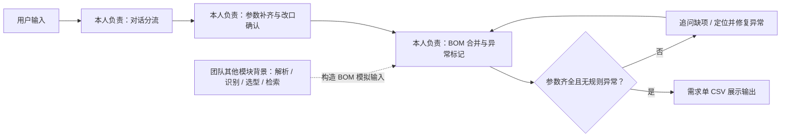

# 料知 · 对话分流与 BOM 校验 Demo

围绕嵌入式物料智能客服场景，为面试独立复现的职责展示项目。演示 **用户表达需求 → 对话分流 → 参数补齐与改口确认 → BOM 合并 → 异常定位 → 导出需求单**。

> 本人负责原项目的开头与结尾：对话流程、打样参数补齐、BOM 合并和异常标记。图纸解析、器件识别、选型和规格书检索属于团队整体流程，不作为本人独立负责或实现的成果。本仓库使用构造 BOM 模拟中间模块的输出。

## 本人负责的部分

| 负责模块 | 本 Demo 展示的行为 |
| --- | --- |
| 对话分流 | 区分问参数、报参数、问替代料、要出单；含混时先反问，显示当前去向 |
| 打样参数补齐 | 维护板层、尺寸、数量、工艺、交期的已填/缺失状态；只追问缺项 |
| 改口与确认 | 提取最新变更，确认后只更新对应字段；拒绝保留原值，展示修改前后 |
| BOM 合并 | 按“型号＋封装”合并数量和位号；同型号不同封装独立保留，追溯来源行 |
| 异常标记与核对 | 重复位号、封装冲突、缺失或不符数量；定位问题字段，核对合并前后数量与位号 |

当前 Demo 通过服务端 DeepSeek API 理解自然语言，通过本地确定性规则处理参数确认、BOM 和出单拦截。人工交接、辅助问答及导出作为辅助展示，不追溯为原实习贡献。

## 在线体验

在线部署适配已准备，正在迁移到 Vercel；通过实际访问验证后再补充正式体验链接。此前 Sites 地址在目标网络被拦截，不作为面试入口。

无需安装或下载源码。使用构造示例体验对话、参数确认、BOM 合并和异常修复；模型体验达到限制后可切换“离线规则演示”继续操作。在线页面与 GitHub 均不包含真实 DeepSeek 密钥。部署方式与请求边界见 [在线部署说明](docs/online-deployment.md)。

## 流程与职责边界



## 快速运行

需要 **Node.js 20.12+**，推荐 Node.js 24。服务运行本身没有第三方依赖。

```sh
git clone https://github.com/FriendRan/material-copilot-demo.git
cd material-copilot-demo
node server.mjs
```

打开 [本地 Demo](http://127.0.0.1:4173/)，选择“离线规则演示”即可体验，不需要密钥。

### 使用真实 DeepSeek 对话

在项目根目录将 `.env.example` 复制为 `.env`：

```powershell
# Windows PowerShell
Copy-Item .env.example .env
```

```sh
# macOS / Linux
cp .env.example .env
```

编辑本机 `.env`，仅填写自己的密钥：

```dotenv
DEEPSEEK_API_KEY=YOUR_DEEPSEEK_API_KEY
LLM_BASE_URL=https://api.deepseek.com
LLM_MODEL=deepseek-flash
PORT=4173
```

重新运行 `node server.mjs`，在页面选择“DeepSeek 自然对话”。模型名可根据账户支持情况调整。使用者需要自己的 API Key 和可用额度；修改 `.env` 后需重启服务。详细说明见 [DeepSeek 配置](docs/deepseek-setup.md)。

**仓库不包含真实密钥。** `.env`、本机凭证和 `node_modules/` 不提交；浏览器也不会收到密钥。自然对话发送本次输入、最近最多 12 条对话、确认参数和 BOM 校验摘要到 DeepSeek，完整 BOM 只在本机服务计算。

## 两分钟演示步骤

| 步骤 | 操作 | 观察重点 |
| --- | --- | --- |
| 缺项追问 | 发送 `4层，100x80mm，先做10块`，点击“确认更新” | 分流为报参数；只剩工艺、交期待补充，先问工艺 |
| 补齐需求 | 发送 `沉金，7天` 并确认 | 五项参数齐全，已填内容不被重复追问 |
| 中途改口 | 发送 `改成20块，其他不变` 并确认 | 数量 10 → 20，其他字段不变 |
| 拒绝修改 | 发送 `改成30块`，点击“暂不修改” | 仍为 20 块，建议不直接写入需求 |
| 四类分流 | 点击问参数、问替代料、要出单、不确定意图 | 当前去向与反问入口；咨询不改需求 |
| 合并核对 | 加载“同键合并示例” | 原始第 1、2 行合并，第 3 行封装不同独立保留；数量与位号均 6 / 6 |
| 异常定位 | 加载“三类异常示例”，点击异常 | 重复位号两端标记，定位封装和数量字段；异常时禁止导出 |
| 修复导出 | 应用示例修复或手动改正，再导出 CSV | 规则通过后允许导出，20 块板下 3 个单板电阻对应总需求 60 个 |

加载示例 BOM 前会确认替换，对话和需求保留；不会自动发起模型调用。待确认建议不会被新消息或切换模式静默丢弃，新输入保留在输入框。

详细讲解话术见 [面试演示脚本](docs/demo-guide.md)。生成结果样本：[立创字段顺序](docs/acceptance/打样需求单_立创.csv)、[嘉立创字段顺序](docs/acceptance/打样需求单_嘉立创.csv)。

## 测试

安装开发依赖后运行自动测试，无需 API Key，不调用外部模型：

```sh
corepack pnpm install --frozen-lockfile
corepack pnpm test
```

也可用 `npm install`、`npm test`；仓库以 `pnpm-lock.yaml` 固定测试依赖。Happy DOM 仅用于开发测试，不影响无依赖启动服务。

当前 **39 项自动测试通过**，覆盖核心规则、API 错误处理、参数确认、页面事件及在线会话/密钥隔离。另用 **10 条真实 DeepSeek 对话**验证了分流、缺项补齐、改口、拒绝修改与不确定意图，并核验 BOM 定位和两种导出内容。

- [检查记录与验证限制](docs/interaction-checks.md)
- [真实模型交互记录（构造数据）](docs/acceptance/interactions.json)

可选现场验收（需先启动配置好的服务，会调用真实 API 并产生费用）：

```sh
corepack pnpm run test:live
```

页面测试使用隔离内存 DOM，验证按钮、表单、焦点和下载内容；不代表原生浏览器布局、操作系统下载或全面语义准确率已经通过验证。

## 主要文件

```text
public/
  index.html       职责演示台、项目说明与职责边界
  app.js           对话、状态、确认和页面交互
  core.js          参数规则、BOM 合并与异常校验、CSV
  showcase.js      面试样例与意图去向
  proposals.js     参数建议与确认
  handoff.js       辅助人工交接
server.mjs         本机 HTTP 服务与同源 API
llm.mjs            DeepSeek 提示词、适配及输入输出验证
tests/             核心测试与隔离页面事件测试
scripts/           可选真实模型验收
online/            在线 Worker 入口（运行时读取 Secret）
docs/              配置、演示步骤与构造数据验收记录
```

## 演示边界

- 仅聚焦本人负责的入口和出口，数据均为独立构造，不包含实习单位资料。
- 型号封装冲突只配置 `RC0603 → 0603` 示例规则；未检出异常不代表已完成真实规格书认证。
- 异常行保留在合并预览中；数量守恒、位号保留一致不能替代重复位号等业务校验。
- CSV 支持中英文表头、引号内多位号，导入限 1MB / 1000 行。两种导出顺序是演示模板，不保证厂商上传兼容。
- 人工协助仅生成本地交接单；没有真实坐席、图纸识别、联网库存或真实下单接口。
- 同时提供源代码、本地运行与在线体验。本地服务仅监听本机；在线版使用独立的服务端 Worker，密钥保存在托管端 Secret 中。GitHub Pages 不能运行模型代理或保存密钥。
