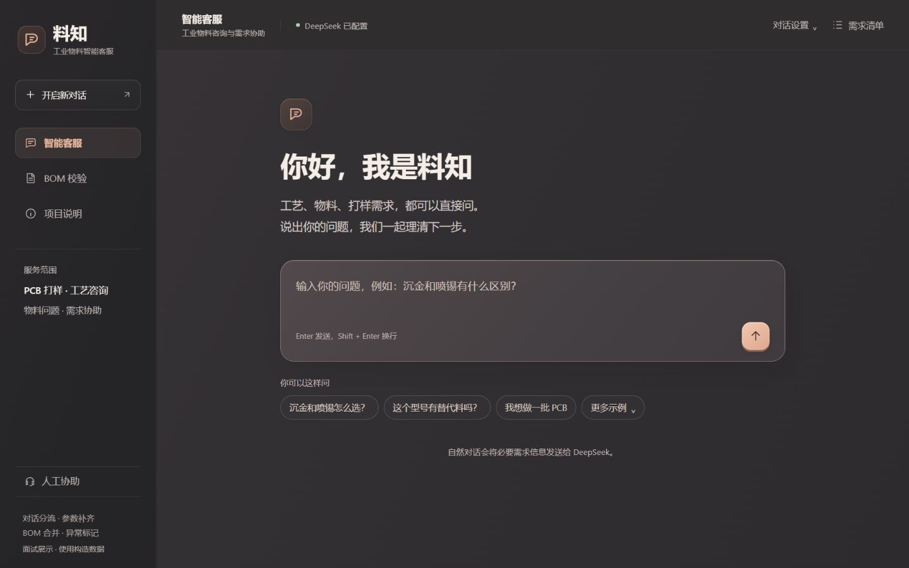
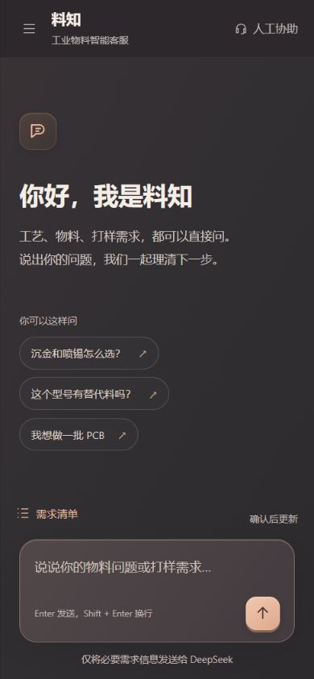

# 料知 · 工业物料智能对话助手

面向 PCB 打样场景的面试展示 Demo，复现本人负责的四个部分：对话分流、参数补齐、BOM 合并与异常标记。通过自然对话确认需求，再核对物料、定位问题，修复后导出需求单。

[在线体验，无需下载](https://material-copilot-demo-ui.onrender.com/) · [两分钟演示](#两分钟演示) · [本地运行](#本地运行) · [详细讲解脚本](docs/demo-guide.md)

- 在线演示：[https://material-copilot-demo-ui.onrender.com/](https://material-copilot-demo-ui.onrender.com/)
- GitHub 仓库：[https://github.com/FriendRan/material-copilot-demo](https://github.com/FriendRan/material-copilot-demo)

> 本仓库是围绕个人职责独立复现的展示项目，使用构造需求和 BOM，不包含实习单位资料。图纸解析、器件识别、选型及规格书检索属于团队其他模块，Demo 通过示例 BOM 承接这些环节的输出。

## 我负责的四个部分

| 个人职责 | Demo 中的实现与观察点 |
| --- | --- |
| 对话分流 | 区分问参数、报参数、问替代料、要出单四类意图，展示当前处理去向；意图不明确时先反问确认。咨询不会直接改写需求。 |
| 参数补齐 | 维护板层、尺寸、数量、工艺、交期五项参数，仅追问缺项；改口先生成变更建议，用户确认后才更新对应字段，也可拒绝修改。 |
| BOM 合并 | 以“型号＋封装”为组合键，汇总数量与位号；同型号不同封装独立保留，合并结果可点击回查原始来源行。 |
| 异常标记 | 标记位号重复、示例型号与封装冲突、数量缺失及数量与位号条目不一致；定位到行和字段，核对合并前后数量与位号守恒。 |

当前 Demo 使用 DeepSeek 理解自然语言并提出参数建议，由程序维护已确认状态、执行 BOM 合并与规则校验。DeepSeek 接入、辅助问答、人工交接和 CSV 导出用于补全展示流程；原实习职责归属以上述四个部分为准。

## 最新界面

暖墨与杏橙配色，以智能客服对话为主体：柔暗哑光背景、缎面侧栏和带细微高光的输入区。以下为最新已上线版本的实际截图，不是设计效果图。

### 桌面端

侧栏导航与对话区铺满窗口，首屏直接展示问答入口；需求清单、对话设置和人工协助按需打开。进入需求收集后，保留分流去向、参数确认卡片和已确认清单。



### 手机端

手机端单独组织首屏与底部输入区；空会话聚焦输入时，欢迎内容和示例向上渐隐，退出后恢复并保留草稿。需求清单从底部展开，消息区底部保留轻微渐隐，BOM 表格在自身区域横向滚动。



参数确认、需求清单、对话设置与人工协助沿用统一的深色表面、圆角和关闭控件。人工协助仅保存和下载本地交接单，不连接真人客服。

四项职责的观察位置：对话中查看意图分流、缺项追问与改口确认；进入“BOM 校验”查看同键合并、来源行和异常定位，修复后导出需求单。所有需求及 BOM 均为构造示例。

## 两分钟演示

打开 [在线 Demo](https://material-copilot-demo-ui.onrender.com/)，从一组新需求开始。以下是约两分钟的操作路径；真实模型等待时间受网络影响。需要控制演示时长时，可在“对话设置”中选择“离线规则演示”，沿用同一套确认与校验流程。

| 时间 | 操作 | 展示重点 |
| --- | --- | --- |
| 0:00–0:25 | 发送 `4层，100x80mm，先做10块`，点击“确认更新”，再展开“分流说明”。 | 当前分流为“报参数”；确认板层、尺寸、数量，只追问尚缺的工艺和交期。 |
| 0:25–1:00 | 发送 `沉金，7天` 并确认，再发送 `改成20块，其他不变`。先对比确认卡片与原值，再确认更新。 | 五项参数补齐；数量 10 → 20，其余字段保持原值。 |
| 1:00–1:25 | 进入“BOM 校验”，加载“同键合并示例”并确认替换。点击合并结果的来源行。 | 原始第 1、2 行合并为数量 3；第 3 行封装不同独立保留。数量与位号条目均为 6 / 6，可回查来源。 |
| 1:25–2:00 | 加载“异常检查示例”，点击异常行号定位字段；点击“应用示例修复”，选择字段顺序并导出。 | 重复位号、封装冲突和数量问题可定位；修复后解除导出拦截。20 块板下，单板 3 个电阻对应总需求 60 个。 |

可继续体验的分支：

- 在“更多示例”中选择问参数、问替代料、要出单或不确定意图，观察分流与反问。选择后会直接发起对话。
- 发送 `改成30块` 后选择“暂不修改”，验证数量仍为 20。
- 打开“人工协助”，填写备注后关闭、重新打开，查看草稿保留；保存后可下载交接单 JSON。

首屏的圆角问题入口只填入草稿，需要手动发送；开始收集参数后显示“补齐参数”“修改数量”。加载 BOM 示例会确认替换当前物料，保留参数与对话。桌面端从顶部、手机端从输入栏上方打开“需求清单”；展开或关闭不会修改参数。

免费静态前端可直接显示界面，真实对话通过免费后端调用 DeepSeek。后端闲置后首次连接可能等待约一分钟，页面会显示状态；期间可查看 BOM 或选择离线演示，已输入内容会保留。完整话术见 [面试演示脚本](docs/demo-guide.md)。

## 本地运行

技术栈为原生 HTML/CSS/JavaScript、Node.js 与 DeepSeek API。需要 Node.js 20.12+；应用启动无第三方运行时依赖。

```sh
git clone https://github.com/FriendRan/material-copilot-demo.git
cd material-copilot-demo
node server.mjs
```

打开 [http://127.0.0.1:4173/](http://127.0.0.1:4173/)，在“对话设置”中选择“离线规则演示”，即可不填密钥体验。

使用真实模型时，将 `.env.example` 复制为 `.env`，仅在本机填写自己的 `DEEPSEEK_API_KEY`，再启动或重启服务：

```powershell
# Windows PowerShell
Copy-Item .env.example .env
# 编辑本机 .env 后启动
node server.mjs
```

macOS / Linux 使用 `cp .env.example .env`。配置项见 [DeepSeek 接入说明](docs/deepseek-setup.md)。调用模型需要可用 API 额度。

密钥只在服务端读取；`.env`、本机凭证与依赖目录不提交。自然对话会把必要的输入、近期历史、已确认参数和 BOM 校验摘要发送给 DeepSeek。

## 验证与代码入口

55 项自动测试覆盖核心规则、参数确认、页面交互、API 与静态构建边界。最新界面已在线检查桌面 1440 × 900 与手机 390 × 844 的布局，并验证真实 DeepSeek 参数建议、公开资源与源代码一致，以及密钥文件不可下载。测试使用构造数据；手机视口模拟不等同于物理设备键盘或全部浏览器的兼容认证。历史布局、来源定位、异常修复与 CSV 导出检查记录见下方链接。

```sh
pnpm install --frozen-lockfile
pnpm test
```

测试依赖使用 `package.json` 中声明的 pnpm 11.25.0 与仓库锁文件。Happy DOM 仅用于开发测试。

| 代码入口 | 作用 |
| --- | --- |
| `public/app.js`、`public/proposals.js` | 对话交互、已确认状态与参数变更。 |
| `public/core.js`、`public/showcase.js` | BOM 合并、异常规则、CSV 与构造场景。 |
| `public/handoff.js` | 本地交接快照与更新检查。 |
| `llm.mjs`、`server.mjs` | DeepSeek 适配、输入输出验证与本机 API。 |
| `online/`、`render.yaml` | 在线服务入口与托管配置。 |

检查记录：[响应式布局](docs/acceptance/responsive-review.json) · [字体与交接流程](docs/acceptance/detail-review.json) · [真实模型交互](docs/acceptance/interactions.json) · [在线部署与密钥边界](docs/online-deployment.md)。

## 展示边界

- 聚焦本人负责的入口对话与出口 BOM，中间团队模块通过构造数据承接。
- 封装冲突仅包含 `RC0603 → 0603` 示例规则；通过规则不等于完成真实器件规格书认证。
- 合并预览保留异常数据，守恒核对与业务异常检查分别执行。
- CSV 导入限 1MB / 1000 行；立创、嘉立创两种字段顺序为演示模板，不保证厂商上传兼容。
- 人工协助仅生成本地交接单；库存、采购与厂商下单不在本项目范围内。
- 草稿保存在当前浏览器；在线限制为进程内的轻量演示限制。项目不宣称生产规模、准确率或全局硬性费用上限。
