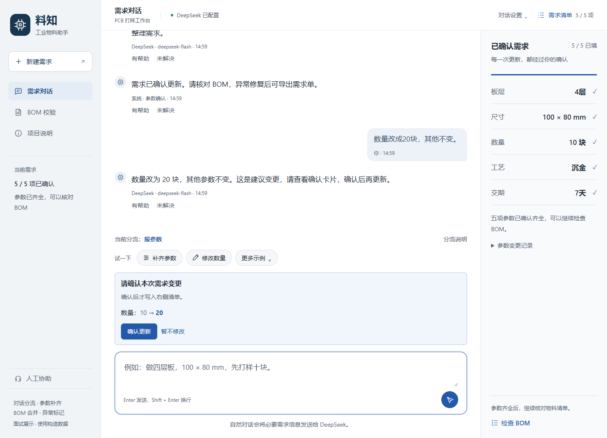
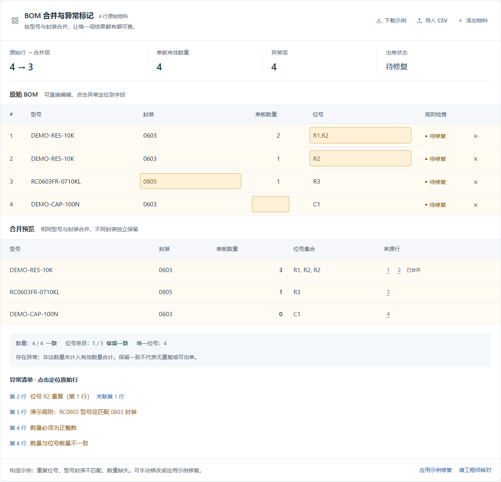

# 料知 · 工业物料智能对话助手

面向 PCB 打样场景的个人职责复现 Demo：通过自然对话收集需求，确认参数变更，再完成 BOM 合并、异常定位与修复后导出。

[在线体验：无需下载代码](https://material-copilot-demo-ui.onrender.com/) · [两分钟演示](#两分钟演示) · [本地运行](#本地运行) · [面试讲解脚本](docs/demo-guide.md)

在线地址：https://material-copilot-demo-ui.onrender.com/

> 本仓库独立复现原项目中本人负责的四个部分。数据均为构造示例，不包含实习单位资料；图纸解析、器件识别、选型和规格书检索属于团队其他模块，不作为本人独立成果。

## 我负责的四个部分

| 负责模块 | 实现与展示重点 |
| --- | --- |
| 对话分流 | 区分问参数、报参数、问替代料、要出单四类意图；含混表达先反问确认，展示当前处理去向。 |
| 参数补齐 | 维护板层、尺寸、数量、工艺、交期五项参数，仅追问缺项；用户改口时先提出建议，确认后只更新对应字段，支持拒绝修改。 |
| BOM 合并 | 按“型号＋封装”汇总数量与位号，同型号不同封装独立保留；合并结果可追溯到原始来源行。 |
| 异常标记 | 基于预设规则检查重复位号、封装冲突、数量缺失或不匹配；定位异常行与字段，核对合并前后数量及位号守恒。 |

DeepSeek 负责理解自然语言并提出参数建议；程序负责确认状态、BOM 规则校验与导出拦截。人工协助、辅助问答和 CSV 导出作为流程配套展示，不追溯为原实习贡献。

## 当前界面

截图来自已上线的工业蓝灰界面，使用构造需求与真实托管 DeepSeek 对话，不含企业资料或密钥。当前版本采用对话工作区与已确认需求单的层级，设计依据、技能来源与验证范围见 [界面设计说明](docs/ui-design.md)。

### 需求对话与参数确认

用户提出“数量改成 20 块”后，先展示变更建议，右侧仍保留已确认的 10 块；确认后才更新。



<details>
<summary>查看 BOM 合并与异常定位截图</summary>

相同型号与封装合并，保留来源行；异常字段高亮，并列出可点击定位的问题清单。



</details>

## 两分钟演示

打开 [在线 Demo](https://material-copilot-demo-ui.onrender.com/)，按下列顺序操作。默认使用真实 DeepSeek；也可展开对话区右上角的“对话设置”，选择“离线规则演示”体验同一套确认与校验流程。

| 步骤 | 操作 | 面试官可观察的结果 |
| --- | --- | --- |
| 1. 提供部分参数 | 发送 `4层，100x80mm，先做10块`，点击“确认更新”。 | 分流为“报参数”；板层、尺寸、数量被确认，只追问剩余工艺和交期。 |
| 2. 补齐并改口 | 发送 `沉金，7天` 并确认，再发送 `改成20块，其他不变` 并确认。 | 五项参数齐全；数量由 10 改为 20，其他字段保持原值。可再尝试“改成30块”并选择“暂不修改”。 |
| 3. 查看意图去向 | 展开“更多示例”，体验“问参数”“问替代料”“要出单”；也可尝试“不确定意图”。 | 咨询不改需求，出单先检查缺项和异常，含混需求出现反问与四类快捷确认入口。 |
| 4. 核对合并 | 切到顶部“BOM 校验”，加载“同键合并示例”。 | 原始第 1、2 行合并，第 3 行封装不同独立保留；数量与位号条目均为 6 / 6，点击来源行可回查。 |
| 5. 定位异常 | 加载“异常检查示例”，点击异常清单中的行号。 | 重复位号两端、封装冲突及数量问题定位到对应字段；存在异常时禁止导出。 |
| 6. 修复并导出 | 点击“应用示例修复”或手动修正，再导出需求单。 | 通过规则检查后允许导出；20 块板下，3 个单板电阻对应总需求 60 个。 |

加载示例前会确认替换 BOM，已填参数与对话保留；切换页签也会保留待确认建议和输入草稿。模型回复速度受网络与服务情况影响。完整话术见 [面试演示脚本](docs/demo-guide.md)。

前端由 Render 免费静态站点直接提供，打开即可查看界面；真实对话仍使用免费后端。后端闲置后首次唤醒通常约需一分钟，页面会显示等待提示，期间可查看 BOM 或使用离线规则演示。需求可以先输入，连接后只发送一次；可随时停止等待，不自动重试模型调用。旧地址 `https://material-copilot-demo.onrender.com/` 保留为后端兼容入口，简历请使用上面的静态站点地址。

## 本地运行

技术栈：JavaScript、Node.js、DeepSeek API、HTML/CSS。需要 Node.js 20.12+，推荐 Node.js 24；应用运行没有第三方依赖。

```sh
git clone https://github.com/FriendRan/material-copilot-demo.git
cd material-copilot-demo
node server.mjs
```

打开 http://127.0.0.1:4173/ ，在“对话设置”中选择“离线规则演示”，即可不填密钥体验。

使用真实模型时，将 `.env.example` 复制为 `.env`，仅在本机填写自己的 `DEEPSEEK_API_KEY`，再重启服务：

```powershell
# Windows PowerShell
Copy-Item .env.example .env
# 编辑本机 .env 后启动
node server.mjs
```

macOS / Linux 使用 `cp .env.example .env`。模型名可在 `.env` 中调整，详情见 [DeepSeek 配置](docs/deepseek-setup.md)。调用模型需要可用 API 额度，免费托管不免除模型调用费用。

密钥只在服务端使用；`.env`、本机凭证和依赖目录不提交。自然对话发送本次输入、最近最多 12 条历史、已确认参数和 BOM 校验摘要给 DeepSeek，浏览器不会收到 API Key。

## 验证与实现

52 项自动测试覆盖核心规则、参数确认、页面事件、API 错误处理、在线会话边界，以及后端唤醒、停止等待和静态构建边界。另有 75%～200% 浏览器实际缩放及手机／平板视口下的 418 项界面状态检查，覆盖长参数确认、人工交接、菜单、长 BOM 和字段定位，见 [响应式验收](docs/acceptance/responsive-review.json)。构造数据下的真实 DeepSeek 对话、原生 CSV 下载与导出内容另外验收；这些结果不作为生产准确率或线上规模指标。

```sh
pnpm install --frozen-lockfile
pnpm test
```

需要先安装 pnpm 11.25；仓库以 `pnpm-lock.yaml` 固定测试依赖。Happy DOM 仅用于开发测试，不影响无依赖启动应用。

| 文件 | 作用 |
| --- | --- |
| `public/app.js`、`public/proposals.js` | 对话交互、确认状态与参数变更。 |
| `public/core.js`、`public/showcase.js` | BOM 合并、异常规则、CSV 与构造场景。 |
| `llm.mjs`、`server.mjs` | DeepSeek 适配、输入输出验证与本机 API。 |
| `online/`、`render.yaml` | 在线服务入口、会话限制与免费托管配置。 |
| `tests/` | 核心与交互回归测试。 |

更多记录：[界面设计与浏览器检查](docs/ui-design.md) · [真实模型验收](docs/acceptance/interactions.json) · [在线验收](docs/acceptance/render-online.json) · [部署与密钥边界](docs/online-deployment.md)。

## 展示范围

- 只聚焦个人负责的入口对话与出口 BOM；中间团队模块以构造数据模拟。
- 封装冲突仅含 `RC0603 → 0603` 示例规则；规则通过不等于完成真实规格书认证。
- 异常数据保留在合并预览中，守恒核对不能代替重复位号等业务校验。
- CSV 导入限 1MB / 1000 行，两种导出字段顺序为演示模板，不保证厂商上传兼容。
- 人工协助只保存本地交接单；没有真实客服、实时库存或厂商下单接口。
- 在线请求限制是进程内的轻量演示限制，不是全局硬性费用上限；浏览器草稿保存在当前浏览器。
